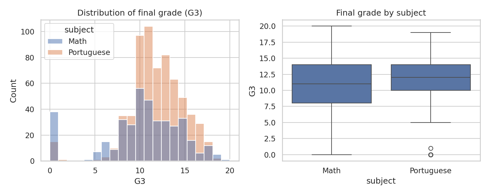
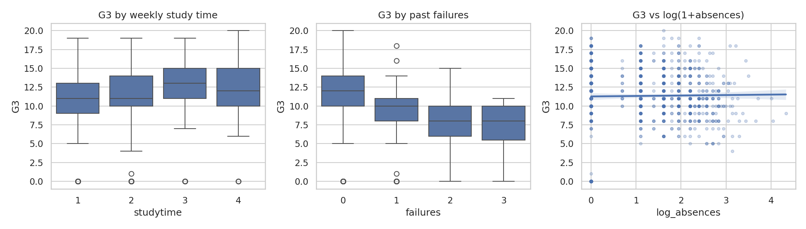
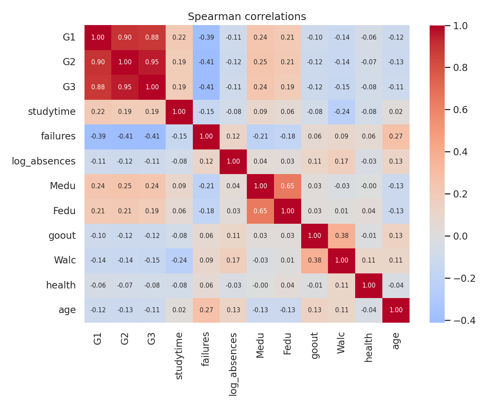
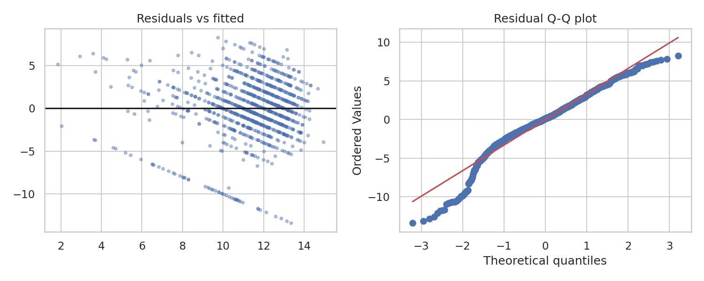

# Student Performance Analysis: Data Cleaning, Statistical Testing and Findings

*Dataset: UCI Machine Learning Repository, "Student Performance" (Cortez and Silva, 2008), licensed CC BY 4.0. Code: `analysis.py` and `build_report.py`. Every figure and table is generated by the code in this repository.*

## Executive summary

**Question.** Which background and behaviour factors are associated with the final grade (G3, scale 0-20) of secondary-school students in Math and Portuguese?

**Data.** 1,044 student-subject records (395 Math, 649 Portuguese) with 33 survey and school variables. The data needed little repair: no missing values and no out-of-range codes. The real cleaning issues were grades stored as text, yes/no fields, a heavy right tail in absences, and 53 students (5.1%) with a final grade of 0.

**Main findings.**
1. **Earlier grades explain most of the final grade.** Spearman rho with G3 is 0.95 for the second-period grade (G2) and 0.88 for G1. Adding G2 to the background model lifts R-squared from about 0.24 to 0.84.
2. **Past failures are the strongest non-grade factor.** Students with no past failures average 12.1 on G3, those with one average 8.4 (rho = -0.41). In the regression each extra past failure is associated with 1.7 fewer grade points (95% CI 1.4 to 2.0).
3. **Educational ambition shows a large gap.** Students who want higher education average 11.6 against 8.4 for those who do not (Cohen d = 0.89), and their pass rate is 81% against 48%.
4. **Family background and study habits matter, but modestly.** Mother's education (rho = 0.24), study time (rho = 0.19) and home internet access (+0.5 points, adjusted) are positively associated; going out and weekend alcohol use are negatively associated.
5. **Sex shows no meaningful difference** (11.45 vs 11.20, Holm-adjusted p = 0.30).
6. **Background factors alone explain about a quarter of the variation** (adjusted R-squared 0.23 to 0.24), so they are useful for screening, not for predicting an individual grade.

**Practical reading.** The data point to early identification of students with prior failures and low academic ambition, as the group where support is most likely to matter. Because the data are observational, these are associations, not proven effects of any programme.

---

## 1. Data and cleaning

- Loaded Math: 395 rows, 33 columns.
- Loaded Portuguese: 649 rows, 33 columns.
- Grades G1, G2, G3 were stored as quoted text; converted to numbers.
- Missing values after conversion: 0.
- Fully duplicated rows across both subjects (excluding subject): 0. Kept: the same student appears in both subject files by design, and no duplicate exists within a file (0 exact duplicates).
- Yes/no columns encoded as 1/0: schoolsup, famsup, paid, activities, nursery, higher, internet, romantic.
- Out-of-range values per column: none.
- Absences: 54 values above the IQR fence (15); kept as real observations, analysed with rank-based methods and a log transform.
- Final grade G3 = 0 for 53 students (5.1%); they have G2 > 0 in 33 cases, i.e. likely dropped out of the final exam. Kept, and results are also shown without them.
- Clean dataset: 1044 rows x 36 columns, saved to data/clean/student_clean.csv.

The analysis sample is 1044 student-subject records (395 Math, 649 Portuguese). Overall 78.0% reached a pass grade (G3 >= 10 on the 0-20 scale).

## 2. Descriptive results

| Subject | n | Mean G3 | SD | Median |
|---|---|---|---|---|
| Math | 395 | 10.42 | 4.58 | 11 |
| Portuguese | 649 | 11.91 | 3.23 | 12 |



**Figure 1.** G3 is slightly left-skewed with a small spike at 0 (students who did not sit the final assessment).

## 3. Group comparisons

Binary predictors use Welch t-tests with Mann-Whitney U as a robustness check, multi-level predictors use Kruskal-Wallis, and pass/fail uses chi-square. P-values in the last column are Holm-adjusted across all tests in this report.

| Comparison | Group summary (mean G3 or pass rate) | Test | Effect size | p | p (Holm) |
|---|---|---|---|---|---|
| Sex | F: 11.45 (SD 3.87) vs M: 11.20 (SD 3.85) | Welch t=1.02, Mann-Whitney p=0.148 | Cohen d=-0.06 | 0.148 | 0.295 |
| Wants higher education (0/1) | 0: 8.35 (SD 3.55) vs 1: 11.62 (SD 3.78) | Welch t=-8.28, Mann-Whitney p=9.27e-18 | Cohen d=0.89 | <0.001 | <0.001 |
| Internet at home (0/1) | 0: 10.53 (SD 3.86) vs 1: 11.55 (SD 3.84) | Welch t=-3.47, Mann-Whitney p=7.4e-05 | Cohen d=0.26 | <0.001 | <0.001 |
| Extra school support (0/1) | 0: 11.45 (SD 3.98) vs 1: 10.49 (SD 2.71) | Welch t=3.44, Mann-Whitney p=6.45e-05 | Cohen d=-0.28 | <0.001 | <0.001 |
| Home address (R/U) | R: 10.60 (SD 3.98) vs U: 11.62 (SD 3.78) | Welch t=-3.74, Mann-Whitney p=1.59e-05 | Cohen d=0.26 | <0.001 | <0.001 |
| Subject | Math: 10.42 (SD 4.58) vs Portuguese: 11.91 (SD 3.23) | Welch t=-5.67, Mann-Whitney p=1.95e-07 | Cohen d=0.38 | <0.001 | <0.001 |
| Weekly study time (1-4) | 1: 10.6; 2: 11.3; 3: 12.5; 4: 12.3 | Kruskal-Wallis H=40.1 | epsilon2=0.036 | <0.001 | <0.001 |
| Past class failures | 0: 12.1; 1: 8.4; 2: 7.5; 3: 6.8 | Kruskal-Wallis H=178.4 | epsilon2=0.169 | <0.001 | <0.001 |
| Mother's education (0-4) | 0: 12.1; 1: 10.2; 2: 11.0; 3: 11.2; 4: 12.5 | Kruskal-Wallis H=67.6 | epsilon2=0.061 | <0.001 | <0.001 |
| Weekend alcohol use (1-5) | 1: 11.7; 2: 11.5; 3: 11.3; 4: 10.5; 5: 10.4 | Kruskal-Wallis H=27.9 | epsilon2=0.023 | <0.001 | <0.001 |
| Pass (G3>=10) vs Wants higher education | pass rate 0: 48%, 1: 81% | chi2=47.9 | Cramer V=0.21 | <0.001 | <0.001 |
| Pass (G3>=10) vs Extra school support | pass rate 0: 78%, 1: 74% | chi2=1.0 | Cramer V=0.03 | 0.314 | 0.314 |
| Pass (G3>=10) vs In a relationship | pass rate 0: 80%, 1: 74% | chi2=6.1 | Cramer V=0.08 | 0.014 | 0.042 |



**Figure 2.** Final grade by study time, past failures and (log) absences.

## 4. Correlations

Spearman rank correlations with G3 (sorted by strength):

| Variable | rho | p | p (Holm) |
|---|---|---|---|
| G2 | 0.95 | <0.001 | <0.001 |
| G1 | 0.88 | <0.001 | <0.001 |
| failures | -0.41 | <0.001 | <0.001 |
| Medu | 0.24 | <0.001 | <0.001 |
| Fedu | 0.19 | <0.001 | <0.001 |
| studytime | 0.19 | <0.001 | <0.001 |
| Dalc | -0.17 | <0.001 | <0.001 |
| Walc | -0.15 | <0.001 | <0.001 |
| goout | -0.12 | <0.001 | <0.001 |
| traveltime | -0.12 | <0.001 | <0.001 |
| age | -0.11 | <0.001 | 0.002 |
| absences | -0.11 | <0.001 | 0.003 |
| freetime | -0.08 | 0.008 | 0.041 |
| health | -0.08 | 0.009 | 0.041 |



## 5. Regression

Ordinary least squares on G3 using background and behaviour variables only (study time, failures, log absences, wants higher education, parents' education, going out, weekend alcohol, internet, age, sex, subject). Prior grades G1/G2 are left out on purpose so the model describes background factors instead of repeating earlier grades.

**All records** (n=1044, R2=0.238, adjusted R2=0.229)

| Term | Coef | 95% CI | p |
|---|---|---|---|
| intercept | 7.043 | [3.76, 10.33] | <0.001 |
| studytime | 0.429 | [0.16, 0.69] | 0.002 |
| failures | -1.697 | [-2.04, -1.35] | <0.001 |
| log_absences | 0.329 | [0.12, 0.54] | 0.002 |
| higher | 1.772 | [0.97, 2.58] | <0.001 |
| Medu | 0.332 | [0.08, 0.58] | 0.009 |
| Fedu | 0.080 | [-0.17, 0.33] | 0.526 |
| goout | -0.229 | [-0.43, -0.03] | 0.023 |
| Walc | -0.151 | [-0.34, 0.04] | 0.116 |
| internet | 0.595 | [0.07, 1.12] | 0.027 |
| age | 0.015 | [-0.16, 0.19] | 0.870 |
| male | 0.275 | [-0.18, 0.73] | 0.234 |
| portuguese | 1.703 | [1.26, 2.14] | <0.001 |

**Excluding G3 = 0** (n=991, R2=0.250, adjusted R2=0.241)

| Term | Coef | 95% CI | p |
|---|---|---|---|
| intercept | 6.351 | [3.83, 8.87] | <0.001 |
| studytime | 0.313 | [0.11, 0.52] | 0.003 |
| failures | -1.178 | [-1.46, -0.90] | <0.001 |
| log_absences | -0.474 | [-0.64, -0.31] | <0.001 |
| higher | 1.484 | [0.85, 2.12] | <0.001 |
| Medu | 0.368 | [0.18, 0.56] | <0.001 |
| Fedu | 0.055 | [-0.13, 0.24] | 0.565 |
| goout | -0.214 | [-0.37, -0.06] | 0.007 |
| Walc | -0.187 | [-0.33, -0.04] | 0.011 |
| internet | 0.494 | [0.09, 0.90] | 0.018 |
| age | 0.216 | [0.08, 0.35] | 0.002 |
| male | 0.128 | [-0.22, 0.47] | 0.469 |
| portuguese | 0.671 | [0.33, 1.01] | <0.001 |

For context, adding the mid-year grade G2 raises R2 to 0.844 (adjusted 0.842): prior performance is by far the strongest predictor.



**Figure 4.** Residuals are roughly symmetric, with a visible tail from the zero-grade students, which is why the model is repeated without them.


## 6. Interpretation

**Absences change sign between the two regression runs.** With zero-grade students included, log absences has a small positive coefficient; without them it is negative (-0.47). Many students who skipped the final assessment have zero recorded absences, which creates a misleading positive link. The model without G3 = 0 is the better description of students who took the exam.

**Extra school support looks harmful but is not.** Students who receive extra support score lower on average (10.5 vs 11.5). This is most likely selection: schools give support to students who are already struggling. The test cannot show that support lowers grades, and it should not be read that way.

**Subject differences.** Portuguese grades are higher and less spread out than Math grades (mean 11.9, SD 3.2 vs mean 10.4, SD 4.6). The Math distribution carries most of the zero-grade cases.

**Effect sizes.** With 1,044 records, many comparisons are statistically significant even when small. Weekend alcohol use, for example, has epsilon-squared of 0.023. Past failures (0.169) and the higher-education gap (d = 0.89) are the only large effects among non-grade variables.

**Multiple testing.** All tests and correlations in sections 3 and 4 are adjusted with the Holm method. Pass rate by relationship status is the only borderline result after adjustment (p = 0.042).


## 6. Interpretation

**Absences change sign between the two regression runs.** With zero-grade students included, log absences has a small positive coefficient; without them it is negative (-0.47). Many students who skipped the final assessment have zero recorded absences, which creates a misleading positive link. The model without G3 = 0 is the better description of students who took the exam.

**Extra school support looks harmful but is not.** Students who receive extra support score lower on average (10.5 vs 11.5). This is most likely selection: schools give support to students who are already struggling. The test cannot show that support lowers grades, and it should not be read that way.

**Subject differences.** Portuguese grades are higher and less spread out than Math grades (mean 11.9, SD 3.2 vs mean 10.4, SD 4.6). The Math distribution carries most of the zero-grade cases.

**Effect sizes.** With 1,044 records, many comparisons are statistically significant even when small. Weekend alcohol use, for example, has epsilon-squared of 0.023. Past failures (0.169) and the higher-education gap (d = 0.89) are the only large effects among non-grade variables.

**Multiple testing.** All tests and correlations in sections 3 and 4 are adjusted with the Holm method. Pass rate by relationship status is the only borderline result after adjustment (p = 0.042).


## 6. Interpretation

**Absences change sign between the two regression runs.** With zero-grade students included, log absences has a small positive coefficient; without them it is negative (-0.47). Many students who skipped the final assessment have zero recorded absences, which creates a misleading positive link. The model without G3 = 0 is the better description of students who took the exam.

**Extra school support looks harmful but is not.** Students who receive extra support score lower on average (10.5 vs 11.5). This is most likely selection: schools give support to students who are already struggling. The test cannot show that support lowers grades, and it should not be read that way.

**Subject differences.** Portuguese grades are higher and less spread out than Math grades (mean 11.9, SD 3.2 vs mean 10.4, SD 4.6). The Math distribution carries most of the zero-grade cases.

**Effect sizes.** With 1,044 records, many comparisons are statistically significant even when small. Weekend alcohol use, for example, has epsilon-squared of 0.023. Past failures (0.169) and the higher-education gap (d = 0.89) are the only large effects among non-grade variables.

**Multiple testing.** All tests and correlations in sections 3 and 4 are adjusted with the Holm method. Pass rate by relationship status is the only borderline result after adjustment (p = 0.042).

## 7. Limitations
- Observational data from two schools in Portugal (2005-2006); results show association, not cause.
- Some students appear in both subject files, so records are not fully independent.
- Self-reported variables (alcohol, study time) can be biased.
- G3 = 0 mixes true zero performance with missing the final exam.
- Grades are ordinal; rank-based tests were used for that reason, and OLS is shown for interpretability.

## 8. Recommendations for follow-up work

1. Model G3 = 0 separately, as a dropout or non-attendance problem, using a logistic model.
2. Use a mixed-effects model with a student identifier to handle students who appear in both subjects.
3. Treat grades as ordinal and compare with an ordered logit model.
4. Validate any predictive use on a held-out school or year.

## 9. Reproducibility

```
pip install pandas numpy scipy matplotlib seaborn
python analysis.py        # cleaning, tests, figures, results tables
python build_report.py    # assembles the written report
```
All outputs are written to `data/clean`, `figures` and `reports`. Raw data are unchanged in `data/raw`.

## 10. Data source and licence

Paulo Cortez and Alice Silva (2008). *Using Data Mining to Predict Secondary School Student Performance.* Proceedings of 5th FUture BUsiness TEChnology Conference (FUBUTEC 2008), pp. 5-12. Dataset from the UCI Machine Learning Repository, released under the Creative Commons Attribution 4.0 International licence (CC BY 4.0). This project redistributes the raw files unchanged with attribution and adds a cleaned copy.
## 7. Limitations
- Observational data from two schools in Portugal (2005-2006); results show association, not cause.
- Some students appear in both subject files, so records are not fully independent.
- Self-reported variables (alcohol, study time) can be biased.
- G3 = 0 mixes true zero performance with missing the final exam.
- Grades are ordinal; rank-based tests were used for that reason, and OLS is shown for interpretability.

## 8. Recommendations for follow-up work

1. Model G3 = 0 separately, as a dropout or non-attendance problem, using a logistic model.
2. Use a mixed-effects model with a student identifier to handle students who appear in both subjects.
3. Treat grades as ordinal and compare with an ordered logit model.
4. Validate any predictive use on a held-out school or year.

## 9. Reproducibility

```
pip install pandas numpy scipy matplotlib seaborn
python analysis.py        # cleaning, tests, figures, results tables
python build_report.py    # assembles the written report
```
All outputs are written to `data/clean`, `figures` and `reports`. Raw data are unchanged in `data/raw`.

## 10. Data source and licence

Paulo Cortez and Alice Silva (2008). *Using Data Mining to Predict Secondary School Student Performance.* Proceedings of 5th FUture BUsiness TEChnology Conference (FUBUTEC 2008), pp. 5-12. Dataset from the UCI Machine Learning Repository, released under the Creative Commons Attribution 4.0 International licence (CC BY 4.0). This project redistributes the raw files unchanged with attribution and adds a cleaned copy.


## 8. Recommendations for follow-up work

1. Model G3 = 0 separately, as a dropout or non-attendance problem, using a logistic model.
2. Use a mixed-effects model with a student identifier to handle students who appear in both subjects.
3. Treat grades as ordinal and compare with an ordered logit model.
4. Validate any predictive use on a held-out school or year.

## 9. Reproducibility

```
pip install pandas numpy scipy matplotlib seaborn
python analysis.py        # cleaning, tests, figures, results tables
python build_report.py    # assembles the written report
```
All outputs are written to `data/clean`, `figures` and `reports`. Raw data are unchanged in `data/raw`.

## 10. Data source and licence

Paulo Cortez and Alice Silva (2008). *Using Data Mining to Predict Secondary School Student Performance.* Proceedings of 5th FUture BUsiness TEChnology Conference (FUBUTEC 2008), pp. 5-12. Dataset from the UCI Machine Learning Repository, released under the Creative Commons Attribution 4.0 International licence (CC BY 4.0). This project redistributes the raw files unchanged with attribution and adds a cleaned copy.
## 7. Limitations
- Observational data from two schools in Portugal (2005-2006); results show association, not cause.
- Some students appear in both subject files, so records are not fully independent.
- Self-reported variables (alcohol, study time) can be biased.
- G3 = 0 mixes true zero performance with missing the final exam.
- Grades are ordinal; rank-based tests were used for that reason, and OLS is shown for interpretability.

## 8. Recommendations for follow-up work

1. Model G3 = 0 separately, as a dropout or non-attendance problem, using a logistic model.
2. Use a mixed-effects model with a student identifier to handle students who appear in both subjects.
3. Treat grades as ordinal and compare with an ordered logit model.
4. Validate any predictive use on a held-out school or year.

## 9. Reproducibility

```
pip install pandas numpy scipy matplotlib seaborn
python analysis.py        # cleaning, tests, figures, results tables
python build_report.py    # assembles the written report
```
All outputs are written to `data/clean`, `figures` and `reports`. Raw data are unchanged in `data/raw`.

## 10. Data source and licence

Paulo Cortez and Alice Silva (2008). *Using Data Mining to Predict Secondary School Student Performance.* Proceedings of 5th FUture BUsiness TEChnology Conference (FUBUTEC 2008), pp. 5-12. Dataset from the UCI Machine Learning Repository, released under the Creative Commons Attribution 4.0 International licence (CC BY 4.0). This project redistributes the raw files unchanged with attribution and adds a cleaned copy.


## 8. Recommendations for follow-up work

1. Model G3 = 0 separately, as a dropout or non-attendance problem, using a logistic model.
2. Use a mixed-effects model with a student identifier to handle students who appear in both subjects.
3. Treat grades as ordinal and compare with an ordered logit model.
4. Validate any predictive use on a held-out school or year.

## 9. Reproducibility

```
pip install pandas numpy scipy matplotlib seaborn
python analysis.py        # cleaning, tests, figures, results tables
python build_report.py    # assembles the written report
```
All outputs are written to `data/clean`, `figures` and `reports`. Raw data are unchanged in `data/raw`.

## 10. Data source and licence

Paulo Cortez and Alice Silva (2008). *Using Data Mining to Predict Secondary School Student Performance.* Proceedings of 5th FUture BUsiness TEChnology Conference (FUBUTEC 2008), pp. 5-12. Dataset from the UCI Machine Learning Repository, released under the Creative Commons Attribution 4.0 International licence (CC BY 4.0). This project redistributes the raw files unchanged with attribution and adds a cleaned copy.
